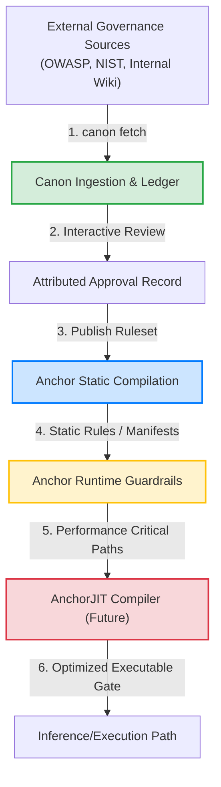

# Governance Stack Architecture

This document describes how **Canon**, **Anchor Static**, **Anchor Runtime**, and the future **AnchorJIT** fit together to form a comprehensive, deterministic, end-to-end governance stack for AI systems.

---

## Architecture Overview

The system is organized into a four-stage pipeline that spans ingestion, compilation, static validation, and dynamic runtime enforcement:

---

## Components

### 1. Canon: Ingestion & Ledger Integrity
* **Role**: Ingestion and baseline verification.
* **Function**: Canon monitors external git repositories, APIs, and document stores. When changes occur in raw policies, Canon creates a structured `EvidencePackage` containing the exact rules changed, added, or removed. A human operator reviews the changes using the approval gate, generating a signed, tamper-evident `ApprovalRecord` appended to a hash-chained ledger (`ledger.jsonl`).
* **Design Principles**: Determinism, zero network dependency during core diff/verification, complete cryptographic accountability.

### 2. Anchor Static: Build-Time Policy Compilation
* **Role**: Translation of natural language regulations into structured schemas and machine-readable tests.
* **Function**: Takes the verified rulesets output by Canon and compiles them into a static policy manifest (e.g., YAML/JSON schemas or AST models). This step validates that policies are syntactically valid and conflict-free before deployment.
* **Integration**: Runs during CI/CD pipelines as a static linting/compilation step.

### 3. Anchor Runtime: Inline Request/Response Guardrails
* **Role**: Live policy enforcement.
* **Function**: Ingests the compiled manifests generated by Anchor Static and validates active LLM requests and responses against them (e.g., checking inputs for prompt injection or outputs for sensitive data leaks).
* **Metrics**: Requires latency guarantees of `<10ms` to avoid slowing down real-time LLM interaction.

### 4. AnchorJIT (Future): Dynamic Enforcement Optimization
* **Role**: Dynamic native compiler for guardrail checks.
* **Function**: As the complexity of rule sets grows (e.g., thousands of rules), checking requests against them dynamically becomes an execution bottleneck. AnchorJIT will dynamically compile active validation paths into highly optimized machine code or pre-indexed search indices directly matching the request payload structure, pushing execution overhead to sub-millisecond ranges.

---

## Governance Lifecycle Sequence

1. **Ingest**: Canon tracks changes upstream and logs updates to the ledger.
2. **Approve**: Compliance officers sign off on rule changes.
3. **Compile**: Anchor Static compiles approved changes into deployable guardrail schemas.
4. **Deploy**: The new schemas are loaded into Anchor Runtime.
5. **Optimize**: AnchorJIT compiles hot execution paths inline.
6. **Enforce**: Guardrail checks run safely alongside LLM execution.
